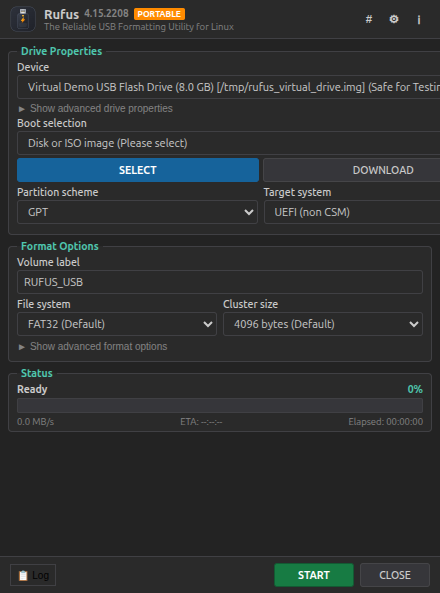

# Rufus for Linux (Portable AppImage & .deb)

<p align="center">
  
</p>

<p align="center">
  <b>The Reliable USB Formatting & Bootable Media Utility for Ubuntu / Debian Linux</b><br>
  <i>A native Linux implementation inspired by Pete Batard's Rufus (v4.15)</i>
</p>

<p align="center">
  
  
  
</p>

---

<p align="center">
  
</p>

## ✨ Highlights

- **Portable AppImage**: Double-click `Rufus-4.15-x86_64.AppImage` to open immediately—**no installation required**.
- **Debian Package**: `rufus_4.15_amd64.deb` provided for standard system-wide installation.
- **Authentic Rufus Interface**: Pixel-perfect layout matching Rufus 4.x with native GTK/GNOME dark and light themes.
- **Drive Properties**:
  - Automatic detection of USB flash drives and external hard drives.
  - **System Drive Safeguard**: Recursively protects OS root (`/`), `/boot`, `/boot/efi`, and system partitions from accidental selection.
  - **USB Hotplug Auto-Detection**: Polls and detects newly plugged-in USB drives automatically.
  - **Virtual Demo Mode**: Safe test disk included for risk-free experimentation without physical drives.
- **Boot Selection**:
  - Supports ISO, IMG, VHD, RAW, and compressed images.
  - Drag-and-drop ISO files directly onto the window.
  - Pure JS ISO-9660 Primary Volume Descriptor (PVD) parser extracting volume names, UEFI/El Torito specs, and OS distro.
  - Partition schemes: **GPT** and **MBR**.
  - Target systems: **UEFI (non CSM)** and **BIOS (or UEFI-CSM)**.
- **Format Options**:
  - File systems: **FAT32**, **NTFS**, **exFAT**, and **ext4**.
  - Customizable cluster sizes (4096B up to 64KB), Quick Format, and bad blocks check.
- **Windows User Experience Customizer**:
  - Automatically activates for Windows 10/11 installation media.
  - Bypass TPM 2.0, Secure Boot, and 4GB+ RAM requirements.
  - Bypass Microsoft online account requirement and auto-create a local user account.
  - Disable telemetry/privacy questions and BitLocker encryption.
- **Checksum / Hash Calculator (`#`)**:
  - Live MD5, SHA1, and SHA256 checksums with one-click copy buttons.
- **In-App OS Downloader**:
  - Download official ISOs directly within the app (Ubuntu 24.04 LTS, Debian 12, Fedora 40, Arch Linux, Linux Mint, Windows 11).
- **Activity Log Window**:
  - Live timestamped diagnostic log with Copy and Clear controls.

---

## 🚀 Getting Started

### 1. Portable AppImage (No Installation Needed)
```bash
chmod +x Rufus-4.15-x86_64.AppImage
./Rufus-4.15-x86_64.AppImage
```
Or double-click `Rufus-4.15-x86_64.AppImage` or `Rufus.desktop` in the Ubuntu file manager.

### 2. Debian Package (.deb Installation)
```bash
sudo dpkg -i rufus_4.15_amd64.deb
```

---

## 🛠️ Development & Building

### Prerequisites
- Node.js (v18+)
- npm

### Run in Development
```bash
npm install
npm start
```

### Run Automated QA Tests
```bash
node test/qa-tests.js
node test/sr-sqa-deep-test.js
node test/gui-e2e-test.js
```

### Build AppImage and .deb
```bash
npm run build
```
Built binaries will be placed in the `dist/` directory.

---

## 📜 License

This project is licensed under the **GNU General Public License v3.0** - see the [LICENSE](LICENSE) file for details.
